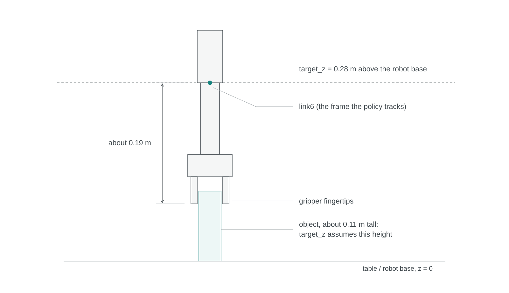
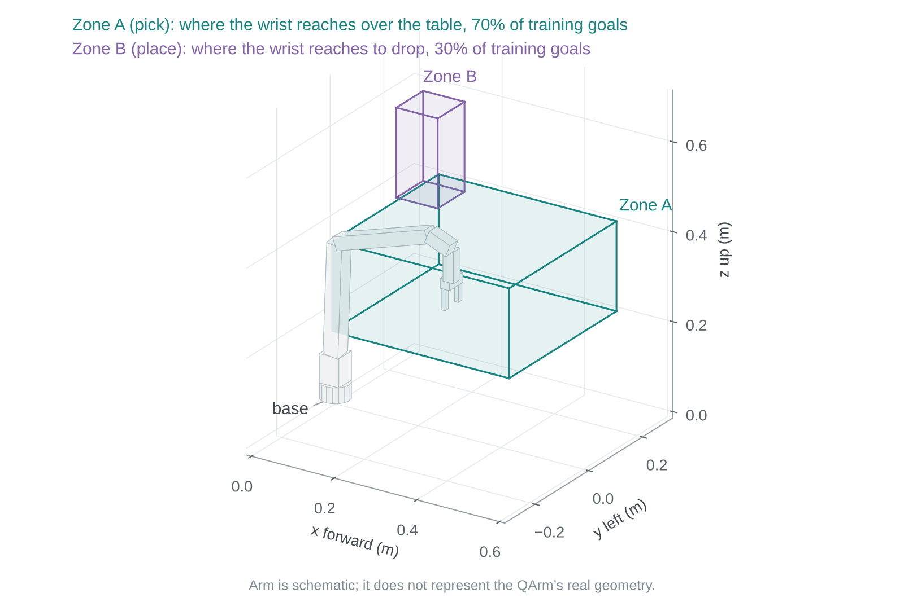
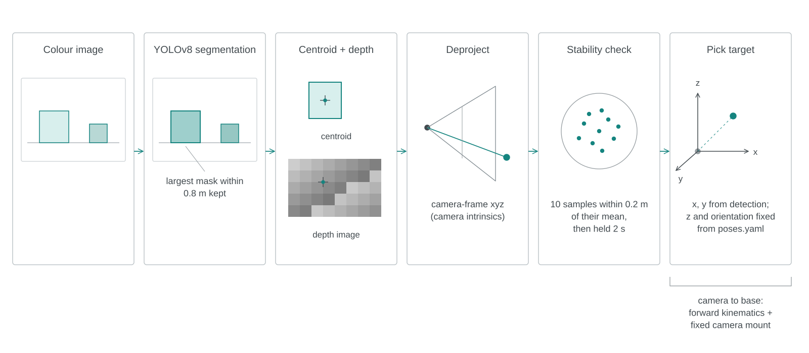
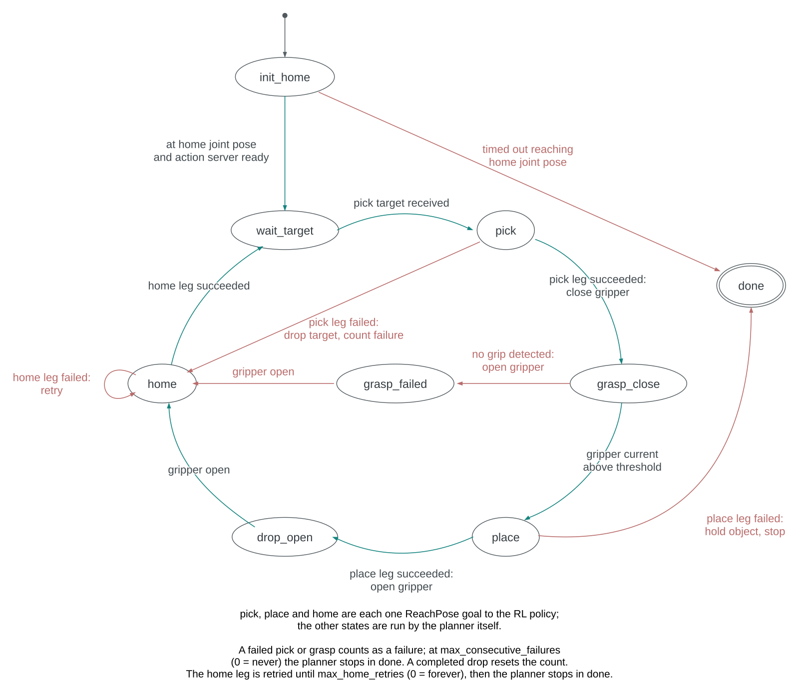
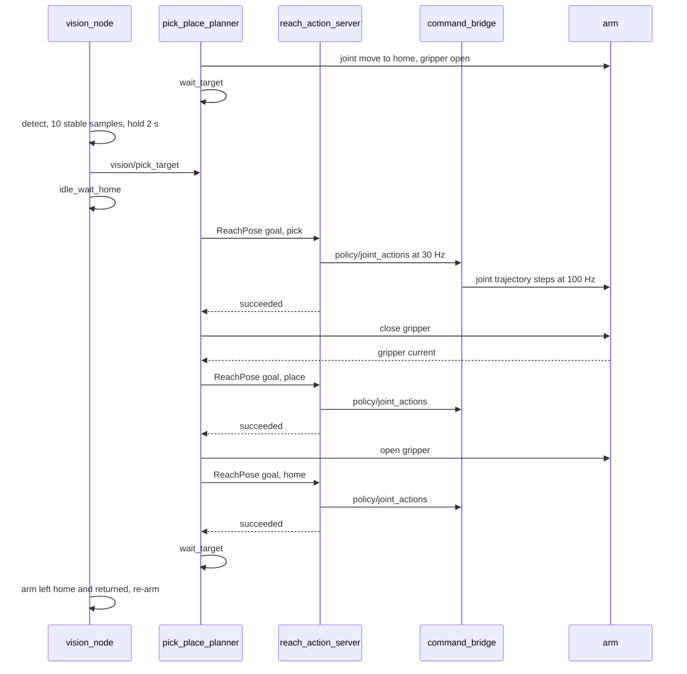

# Reinforcement-learning pick and place

## 1. Introduction

A trained reach policy drives a QArm Research arm through a pick and place cycle. A wrist-mounted
RGB-D camera finds an object on the table, a vision node turns the detection into a pose in the
robot's base frame, and a planner sends that pose, then a place pose, then a home pose to the
policy, one leg at a time. The policy itself only ever does one thing: drive `link6` to a commanded
pose. It was trained on poses inside two zones, which section 6.1 shows. Everything that makes it a
pick and place demo lives in the two state machines around it.


The reference for each node, its topics and its parameters is in the package READMEs:

- [`qarm_research_rl_deploy`](../qarm_research_rl_deploy/README.md), the four deployment nodes.
- [`qarm_research_rl_interfaces`](../qarm_research_rl_interfaces/README.md), the `ReachPose` action
  and the `ObservationStamped` message.
- [`qarm_research_hardware`](../qarm_research_hardware/README.md), the arm's driver interface
  and the RGB-D camera node.

## 2. Prerequisites

The demo runs on the QArm Research's edge device. ROS 2, the QUARC runtime the arm driver's RT
model needs, and the Quanser libraries are already installed on it, so there is no base system to
set up. The camera is the Intel RealSense D405 on the wrist, at the fixed mount the vision node
assumes.

Three things to add:

- This repository cloned into your workspace, as shown below.
- A Python environment for the policy and the detector, as shown below.
- A trained run folder. See section 4.

### Get the source

```bash
mkdir -p ~/ros2_ws/src
cd ~/ros2_ws/src
git clone https://github.com/quanser/qarm_research_ros2.git
```

### Python environment

PyTorch and Ultralytics are not on the device image. Both go in a virtual environment, which the
repository pins:

```bash
python3 -m venv --system-site-packages ~/venvs/qarm_rl
source ~/venvs/qarm_rl/bin/activate
pip install -r ~/ros2_ws/src/qarm_research_ros2/qarm_research_rl_deploy/requirements.txt
```
`requirements.txt` carries an extra index for the CUDA builds of torch, which PyPI cannot serve.
The exact versions are in [Tested on](../qarm_research_rl_deploy/README.md#tested-on).

> **Important:** Keep `--system-site-packages`. Without it the ROS 2 Python packages are invisible 
> from inside the environment, and every node fails on `import rclpy`.


## 3. Build

Activate the venv, then build with `python -m colcon build`. The plain `colcon` command may run
under the system Python, so the node entry points can end up pointing outside the venv, and
`reach_action_server` then fails with `No module named 'torch'`.

```bash
source /opt/ros/jazzy/setup.bash
source ~/venvs/qarm_rl/bin/activate
cd ~/ros2_ws
python -m colcon build --symlink-install
source install/setup.bash
```

## 4. Getting the policy

`run_dir` is the trained policy to deploy, as an Isaac Lab run folder. An example is attached to
this repository's [Releases](https://github.com/quanser/qarm_research_ros2/releases) as a zip, and the release notes  name the file. Unzip it and pass the 
extracted folder. Pass the folder that holds `params/` and `exported/`, not its parent.

For what the folder must contain and what the stack reads out of it, see [the run_dir contract](../qarm_research_rl_deploy/README.md#the-run_dir-folder). 

The example policy is trained as described in section 6.1.

## 5. Running the demo

### Clear the workspace

The first thing the planner does is drive the arm to the home joint pose, with the gripper open.
Make sure that path is clear, and that the object to pick is on the table inside the camera's view.

### Start everything

```bash
ros2 launch qarm_research_rl_deploy pick_place_launch.py run_dir:=<run_dir>
```

This brings up the `qarm_research_hardware` driver, the camera and the four deployment nodes.

### Watch it run

The planner logs each phase as it enters it:

```
Planner phase -> wait_target
Planner phase -> pick
pick leg succeeded at 0.0082 m: Reached target within 0.0100 m
Planner phase -> grasp_close
Grasp confirmed: gripper current 0.5231 > 0.1000.
Planner phase -> place
Planner phase -> drop_open
Planner phase -> home
Planner phase -> wait_target
```

The cycle repeats from `wait_target` as soon as vision publishes a new stable target.

### Look at what the policy sees

```bash
ros2 launch qarm_research_rl_deploy pick_place_launch.py run_dir:=<run_dir> debug:=true
```

That publishes the assembled observation, the absolute joint targets, and the annotated camera
frames, and makes the planner log the distance left on the leg in flight once a second:

```bash
ros2 topic echo /policy/observation
ros2 run rqt_image_view rqt_image_view /vision/debug_image
```

The observation carries a source timestamp per term, so comparing them with the header stamp shows
how old each input was when the policy used it. See [Debug topics](../qarm_research_rl_deploy/README.md#debug-topics).

### Drive one leg by hand

The action server needs no planner, which makes it the quickest way to try a policy. Start only the
driver, the server and the bridge, each in its own terminal, so no vision target can pre-empt the
goal:

```bash
ros2 launch qarm_research_hardware qarm_research_hardware_launch.py
ros2 run qarm_research_rl_deploy reach_action_server --ros-args -p run_dir:=<run_dir>
ros2 run qarm_research_rl_deploy command_bridge --ros-args -p run_dir:=<run_dir>
```

Without the planner there is no startup joint move, so the policy starts from wherever the arm is.
Then send a goal:

```bash
ros2 action send_goal --feedback /policy/reach_pose qarm_research_rl_interfaces/action/ReachPose "{target: {position: {x: 0.35, y: 0.05, z: 0.28}, orientation: {w: 0.0, x: -0.7071, y: 0.7071, z: 0.0}}, position_tolerance_m: 0.02, timeout_sec: 20.0}"
```

The arm moves only while the goal is live. When it ends, the policy stops publishing and
`command_bridge` freezes the arm.
### If something goes wrong

| What you see | What it means |
|---|---|
| `Waiting for synchronised frames` | The `rgbd` node is not publishing. Check the camera. |
| `At the home pose, waiting for the ReachPose action server` | `reach_action_server` is not up; usually it failed to import torch. |
| `No module named 'torch'` | The entry points were written for the system Python. Remove `build/` and `install/`, then rebuild with `python -m colcon build` with the venv active. |
| `Pick leg failed: Timed out ... per-axis error [...]` | The policy could not reach the detected point. The per-axis error says which direction fell short, and a point outside zone A (section 6.1) is one reason it would. |
| `Joint states are N s old` | The driver has stopped publishing or is falling behind. The arm is held where it is. |
| `Grasp failed: gripper current ... <= ...` | The gripper closed on nothing. It reopens and the arm returns home. |
| `Reached max_consecutive_failures` | Repeated unreachable picks. The planner has stopped on purpose. |
| `Camera stability lost. Restarting stability timer.` | The detection is moving or flickering. Vision will not publish until it settles. |
| `Ignoring detections beyond 0.80 m` | Everything the camera found is out of range, usually an object on the floor. Nothing will be published until something in range appears. |

## 6. Code details

Sections 1 to 5 are enough to run the demo. This part explains how it works, for when you change it
or something goes wrong: what the policy was trained on, and the vision node and planner state
machines that turn it into a pick and place cycle.

### 6.1 What the policy was trained to do

One reach policy, trained in Isaac Lab, doing one thing: drive the body `link6` to a commanded
pose. The gripper is not part of the policy, and neither is the notion of picking or placing. Each
leg of the cycle is the same problem with a different command.

The observation, the action, the reward terms, the timing and the curriculum are documented with
the task itself, in [the quanser_rl_lab task README](https://github.com/quanser/quanser_rl_lab/blob/main/docs/qarm_research_reach/README.md). This section covers the two things that page 
leaves out, both read from `params/env.yaml` in the run folder: the numeric command zones, and how 
the poses this demo commands sit against them.

One important detail is that `link6` is the **wrist**, not the fingertips. In this repository's kinematics it is 
the origin of DH frame 5, which`forward_kinematics_ee` computes; the gripper reaches roughly 0.19 m past it. 
That is why `target_z` is 0.28 m for objects sitting on a table, as shown in the figure below.



#### The two command zones



The pose command is a `TwoZoneUniformPoseCommand` during training. Zone A is the pick workspace over 
the table and zone B is the region around the place pose.

A detection further than `max_detection_distance_m` (0.8 m) from the camera is discarded, which
covers the worst case: an object on the floor, which deprojects far outside every zone and leaves
the policy with no behaviour at all rather than a pick that merely goes badly.


### 6.2 The vision node

#### Detection



YOLOv8 segmentation runs on each synchronised and aligned colour and depth pair. Every mask whose 
class is in `target_classes` and whose confidence clears `confidence` (0.75) is a candidate. Each candidate 
is deprojected, at its own median depth, through the intrinsics from `camera/depth_info`, and any
candidate further than `max_detection_distance_m` (0.8 m) from the camera is dropped. The largest
candidate segmentation mask is used to determine reach goal pose.


#### Stability

A single frame is not enough. The node keeps the last `stability_window_size` (10) camera-frame positions 
and calls the detection stable only when they all sit within `stability_position_tolerance_m` (0.2 m) 
of their mean. Once stable, it has to stay stable for `stable_publish_delay_sec` (2 s) before anything 
is published. Losing the detection, or losing stability, restarts the timer.

#### Converting to the base frame

Forward kinematics of the measured joint angles gives the pose of DH frame 6, 0.244 m past `link6`
along the wrist axis, and a fixed transform from there gives the camera. The object's camera-frame
position gets transformed into the base frame.

Only x and y come from the detection. The published z is `target_z` from `poses.yaml`, and the
orientation is `target_quat_wxyz` from the same file, unchanged for every pick. This simplification
assumes the object is at the expected height. Fixing the grasp orientation independently of the 
object's actual pose simplifies the planning and execution.

#### States


After publishing, the node does not look for the next object straight away. It waits until the 
arm has actually left the home tolerance band and then come back and held there for 
`home_hold_cycles` (5) ticks. Its home tolerance (`home_position_tolerance_m`, 0.08 m) i
s deliberately looser than the planner's home leg tolerance (0.05 m), so vision re-arms
once the planner is satisfied the arm is home.

### 6.3 The pick and place planner

#### The normal cycle

`init_home` is the startup phase: a direct joint move to `home_joint_pos` with the gripper opened,
not a policy leg, so the first cycle is guaranteed to start from a known configuration. It also
waits, untimed, for the `ReachPose` action server to appear, since without it there is no cycle to run.

After that, every arm motion is a `ReachPose` goal and the cycle advances on goal results:



A target that arrives in any phase other than `wait_target` is dropped, which is what keeps a
detection published mid-cycle from redirecting the arm.

#### Failure paths

| What failed | What happens | Why |
|---|---|---|
| Pick leg | The stale target is dropped, the arm goes home, and it waits for a fresh detection | Re-reaching the same unreachable point would only fail again |
| Grasp | The gripper reopens, then the arm goes home | The gripper closed on nothing, so there is nothing to place |
| Place leg | The planner halts with the object still held | Better to stop for inspection than drop it somewhere unplanned |
| Home leg | Retried | The cycle cannot continue from anywhere else |
| No result from the policy node | The leg is treated as failed after `result_grace_sec` past its own timeout | The server times each leg; this only covers a server that stopped answering |

`max_consecutive_failures` (0, meaning never) is how many failed picks and failed grasps in a row
halt the planner; a successful drop resets that count. `max_home_retries` (0, meaning forever)
counts retries rather than failures, so the planner halts when the home leg fails
`max_home_retries + 1` times in a row.

#### Per-leg tolerances and timeouts

| Leg | Tolerance | Timeout |
|---|---|---|
| Pick | 0.01 m | 20 s |
| Place | 0.02 m | 20 s |
| Home | 0.05 m | 20 s |

Home is loose on purpose: it is retried until it succeeds, so it has to be comfortably reachable.
The tolerance travels in the goal, and the action server is what decides arrival.

### 6.4 How the two state machines coordinate

They share one topic and one pose, and nothing else:

- `vision/pick_target` is **transient local**, so the planner gets the last target even if it
  subscribes late.
- The planner only accepts a target while it is in `wait_target`.
- Vision re-arms on the home pose, which both nodes read from `poses.yaml`. If the two disagreed
  about where home is, vision would re-arm at the wrong moment.

One full cycle:



## 7. Adapting the example

Every change below is a config edit. What has to stay true is the part worth reading.

**Move the place pose.** Edit `place_target_pose_xyz_wxyz` in `config/poses.yaml`. Keep it inside
zone B, or inside zone A, or retrain: a place pose outside both is a pose the policy never saw, and
the symptom is an unpredictable reach trajectory.

**Pick different objects.** Edit `target_classes` in `config/vision_node.yaml` to the class ids your
segmentation model gives them, and `confidence` if the new class scores lower. A different model
needs `model_filename` as well.

**Objects of a different height.** Edit `target_z` in `config/poses.yaml`. Vision does not measure
height, so this value is the assumption. Keep it inside zone A's z range.

**Change the grasp approach.** Edit `target_quat_wxyz` in `config/poses.yaml`. Keep it near zone A's
roll, pitch and yaw ranges, since the policy's orientation tracking was trained on those.

**Deploy a different policy.** Point `run_dir` at the new run folder. No ROS config changes are
needed: the action scale, the default joint pose, the control rate and the observation layout all
come from that folder's `env.yaml`. Do re-check the poses above against the new run's zones, which
are in the same file under `commands.ee_pose`.

**Move home.** This one is not only a config edit. `home_target_pose_xyz_wxyz` and `home_joint_pos`
have to describe the same point, and vision's re-arm gate uses the same pose. In addition, as the policy 
outputs an offset to the home pose, a new policy need to be trained with the new home position.